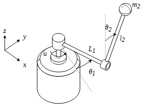

# Furuta Pendulum Example

### Folder structure

In this folder you will find the following files:

* *qLPV_Furuta_SS.m*: computes the continuous-time parameter-varying affine matrices $A_c(\rho)$, $B_c$, and the inertia matrix $M_c(\rho)$.
* *Furuta.m*: simulates the true nonlinear continuous-time ODE of the plant.
* *furuta_init.m*: script to define the MPC problem using the CHRONOS initialization functions.
* *furuta_sim_lpv.m*: script to simulate the pendulum in closed loop, demonstrating the LPV prediction trajectory estimation methods.

### Example introduction

The Furuta pendulum is an underactuated mechanical system composed of a horizontal rotary arm and a pendulum free to rotate along the vertical plane. Its inherently unstable equilibrium, severe nonlinearities, and strong inertial coupling make it a rigorous benchmark for advanced control algorithms.

<!-- [FIGURE PLACEHOLDER] -->

  
   
  <em>Schematic representation of the Furuta pendulum.</em>

The generalized coordinates are defined as $q = [\theta_1 \; \theta_2]^T$, where $\theta_1$ is the arm angle and $\theta_2$ is the pendulum angle ($\theta_2 = 0$ corresponds to the upright unstable equilibrium). The nonlinear mechanical dynamics, derived from Euler-Lagrange equations, are given by:

$$ M(q)\ddot{q} = b u - F\dot{q} - N(q, \dot{q})\dot{q} - d(q) $$

where $u$ is the torque applied to the rotary arm, $M(q)$ is the positive-definite inertia matrix, $N(q, \dot{q})$ contains the Coriolis and centrifugal terms, $F$ is viscous friction, $d(q)$ is the gravitational vector, and $b = [1 \; 0]^T$ is the input mapping vector.

In state-space form, we define the full state vector as $x = [q^T \; \dot{q}^T]^T \in \mathbb{R}^4$. This leads to the continuous-time descriptor representation:

$$ \begin{bmatrix} I_{2} & 0 \\ 0 & M(q) \end{bmatrix} \dot{x} = \begin{bmatrix} 0 & I_{2} \\ f_{d}(q) & -\big(N(q, \dot{q}) + F\big) \end{bmatrix} x + \begin{bmatrix} 0 \\ b \end{bmatrix} u $$

where $f_{d}(q) x$ is an algebraic factorization of the gravity vector $d(q)$.

### From nonlinear to exact qLPV dynamics

A major challenge in controlling the Furuta pendulum using predictive control is dealing with the matrix $M(q)$. Inverting it symbolically leads to highly complex expressions that are prone to singularities and numeric ill-conditioning.

CHRONOS handles this elegantly by natively supporting descriptor systems with a mass/inertia matrix. We map the nonlinearities into a vector of endogenous scheduling parameters $\rho = f_\rho(x)$. In this specific embedding, we simply use the full state as the scheduling parameter ($\rho = x$).

To embed the gravity vector $-d(q) = [0 \;\; \eta \sin(\theta_2)]^T$ linearly with respect to the state without introducing singularities at the equilibrium, we use the unnormalized $\text{sinc}$ function:

$$ \text{sinc}(\theta_2) = \begin{cases} \frac{\sin(\theta_2)}{\theta_2}, & \theta_2 \neq 0 \\ 1, & \theta_2 = 0 \end{cases} $$

This yields $f_d(q) = \begin{bmatrix} 0 & 0 \\ 0 & \eta \text{sinc}(\theta_2) \end{bmatrix}$, allowing us to write exactly $-d(q) = f_d(q) q$. The resulting continuous-time qLPV model is:

$$ M_c(\rho) \dot{x} = A_c(\rho) x + B_c u $$

where $M_c(\rho)$ and $A_c(\rho)$ are the parameter-varying matrices constructed in `qLPV_Furuta_SS.m`.

During the control implementation, `furuta_sim_lpv.m` evaluates the scheduling trajectory over the prediction horizon and passes the continuous 3D arrays to CHRONOS via `update_mpc_dyn_continuous_forward`. The solver automatically performs the LU factorization of the inertia matrix to discretize the dynamics efficiently, avoiding repeated inversions inside the Newton barrier loop.

### MPC Definition

The controller tracks the full state vector (aiming to regulate the pendulum at the upright equilibrium while tracking an arm position reference) over a prediction horizon of $N=40$ samples ($T_s = 20$ ms).

$$ r_k=\begin{bmatrix}\theta_{1,ref} \\ 0 \\ 0 \\ 0\end{bmatrix} $$

The optimization problem solved at each instant $k$ is:

$$
\begin{aligned}
\min_{x,u}\quad
&\frac{1}{2}\sum_{j=1}^{N-1}(r_{k+j}-x_{k+j})^T Q_e (r_{k+j}-x_{k+j}) + \frac{1}{2}(r_{k+N}-x_{k+N})^T P (r_{k+N}-x_{k+N}) + \frac{1}{2}\sum_{j=0}^{N-1} u_{k+j}^T R_u u_{k+j} \\
\text{subject to}\quad
&x_{k+j+1} = A_{d, k+j} x_{k+j} + B_{d, k+j} u_{k+j}, &&j=0,\ldots,N-1,\\
&x_{\min} \le x_{k+j} \le x_{\max}, &&j=1,\ldots,N,\\
&u_{\min} \le u_{k+j} \le u_{\max}, &&j=0,\ldots,N-1.
\end{aligned}
$$

Note that the state constraints are implemented as soft constraints with high-penalty slack variables to ensure the QP remains feasible even under large disturbances. The terminal cost matrix $P$ is computed offline via DLQR using the LPV model frozen at the upright equilibrium.