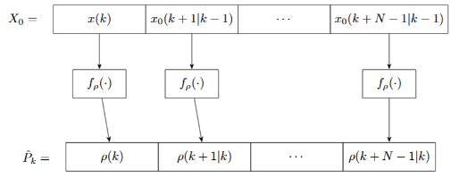

# 2. The LPV-RTI (Warm-Start Evaluation) Approach

The **LPV-RTI Approach** (implemented via `compute_schedul_iterative_fast`) bridges the gap between the low complexity of the Frozen approach and the high accuracy of full nonlinear MPC. Inspired by the Real-Time Iteration (RTI) framework, it constructs a time-varying scheduling trajectory over the prediction horizon by evaluating the scheduling function along the optimal state trajectory predicted at the previous sampling instant.

---

## Conceptual Overview & Visual Scheme

Because **CHRONOS** explicitly retains the primal solution vector from sampling instant $k-1$ to warm-start the interior-point solver at instant $k$, the previously predicted state sequence $X_{k-1}^\star$ is readily available in memory without requiring any additional forward simulation.

At instant $k$:
1. The first scheduling vector ($j=0$) is evaluated exactly at the newly measured state $x(k)$.
2. The remaining $N_p - 1$ steps ($j = 1, \dots, N_p-1$) are evaluated by passing the previous optimal state predictions $x^\star(k+j \mid k-1)$ through the nonlinear mapping $f_\rho(\cdot)$.

<!-- [FIGURE PLACEHOLDER] -->
<p align="center">
  
  <br>
  <em>Figure 1: Mapping the previous optimal state trajectory (warm-start) through the nonlinear scheduling proxy to form the LPV-RTI horizon estimate.</em>
</p>

---

## Mathematical Formulation

Let the optimal state sequence computed at the previous sampling instant $k-1$ be denoted by:

$$X_{k-1}^\star = \text{col}\Big(x^\star(k \mid k-1),\, x^\star(k+1 \mid k-1),\, \dots,\, x^\star(k+N_p-1 \mid k-1)\Big).$$

### 1. Time-Varying Scheduling Trajectory Construction
At the current sampling instant $k$, given the current state measurement $x(k)$, the scheduling parameter at the start of the horizon is exact:

$$\hat{\rho}(k \mid k) = \rho(k) = f_\rho\big(x(k)\big).$$

For the future prediction stages $j \in \{1, \dots, N_p-1\}$, the scheduling parameters are approximated by directly evaluating the nonlinear scheduling proxy on the corresponding states from $X_{k-1}^\star$:

$$\hat{\rho}(k+j \mid k) = f_\rho\Big(x^\star(k+j \mid k-1)\Big), \quad \forall j \in \{1, \dots, N_p-1\}.$$

Stacking these vectors yields the complete LPV-RTI scheduling trajectory estimate $\hat{P}_k \in \mathbb{R}^{n_\rho N_p}$:

$$\hat{P}_k = \begin{bmatrix} f_\rho\big(x(k)\big) \\ f_\rho\big(x^\star(k+1 \mid k-1)\big) \\ \vdots \\ f_\rho\big(x^\star(k+N_p-1 \mid k-1)\big) \end{bmatrix}.$$

*(Note: At the very first sample $k=0$, when no previous QP solution exists yet, the function automatically falls back to a frozen initialization using $x(0)$).*

### 2. Complexity Remark on $f_\rho(x)$
> **Remark:** While LPV-RTI requires solving only **one** QP per sampling instant, it evaluates the nonlinear function $f_\rho(x)$ a total of $N_p$ times per sample over state vectors of dimension $n_x$. For systems with many scheduling parameters and algebraically heavy trigonometric or exponential expressions in $f_\rho(x)$, the evaluation overhead of $N_p$ calls may become non-negligible compared to the Frozen or Taylor approaches.

---

## Implementation in CHRONOS

### Function Signature
```matlab
Pk = compute_schedul_lpv_rti(mpc, x_k, f_rho, n_rho)
```
* **`mpc`**: CHRONOS structure containing the previous primal solution `mpc.x` and state index map `mpc.s_index_k`.
* **`x_k`**: Current measured state vector ($n_x \times 1$).
* **`f_rho`**: Function handle `@(x)` returning the scheduling vector $\rho \in \mathbb{R}^{n_\rho \times 1}$.
* **`n_rho`**: Number of scheduling parameters ($n_\rho$).
* **`Pk`**: Output column vector of dimension $(n_\rho \cdot N_p) \times 1$.

### Complete Closed-Loop Snippet
```matlab
% Define scheduling function handle and affine matrix generator
my_sched_fun = @(x) [1 / sqrt(max(x(1), 1e-4)); 
                     1 / sqrt(max(x(2), 1e-4))];

compute_A = @(rho) eye(2) + Ts * [-k_tank * rho(1),  0; 
                                   k_tank * rho(1), -k_tank * rho(2)];

% Inside the closed-loop control loop at instant k:
Pk    = compute_schedul_iterative_fast(mpc, x_prev, my_sched_fun, n_rho);
A_lpv = project_matrix(compute_A, Pk, n_rho, mpc.N);
mpc   = update_mpc_dynamics(mpc, A_lpv, [], []);

[u_opt, mpc, iter] = mpc_solve(mpc, x_prev, u_prev, y_ref, x_ref, [], [], []);
```

---

## Pros, Cons & When to Use

* **Advantages:**
  * Captures the true time-varying nature of $A(\rho)$ and $B(\rho)$ across the prediction horizon while solving only **a single QP** per sample.
  * Does not require analytical Jacobian derivations or extra inner-loop QP iterations.
* **Limitations:**
  * Relies on the consistency of the previous prediction $X_{k-1}^\star$; if a sudden, massive disturbance or unannounced step change occurs at instant $k$, the warm-start trajectory takes one sampling step to adapt.
* **Best suited for:** The vast majority of nonlinear MPC applications (including demanding tasks like the Furuta pendulum swing-up) where real-time execution speed and high trajectory accuracy are simultaneously required.